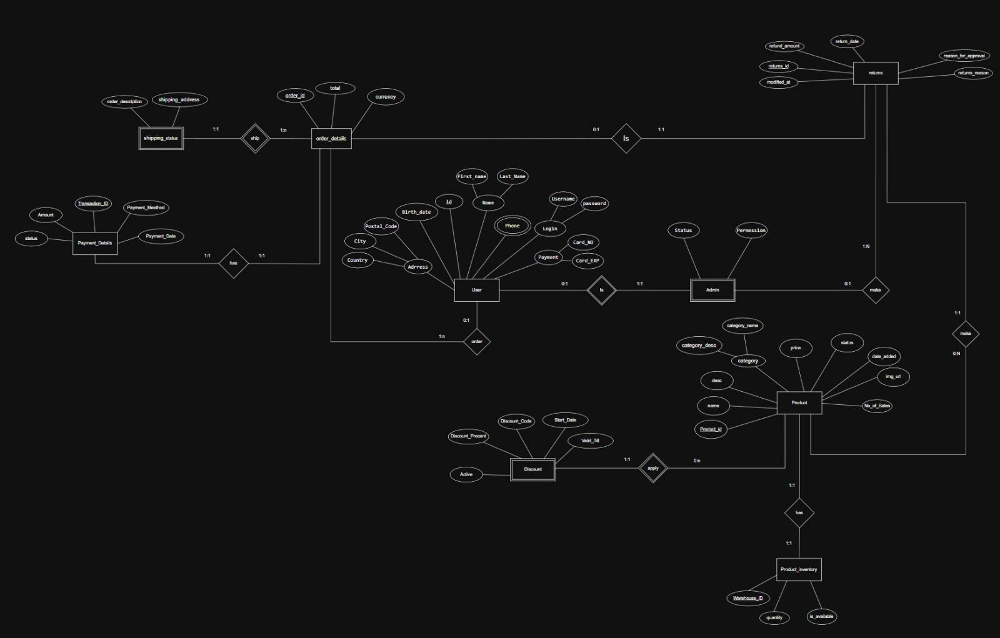
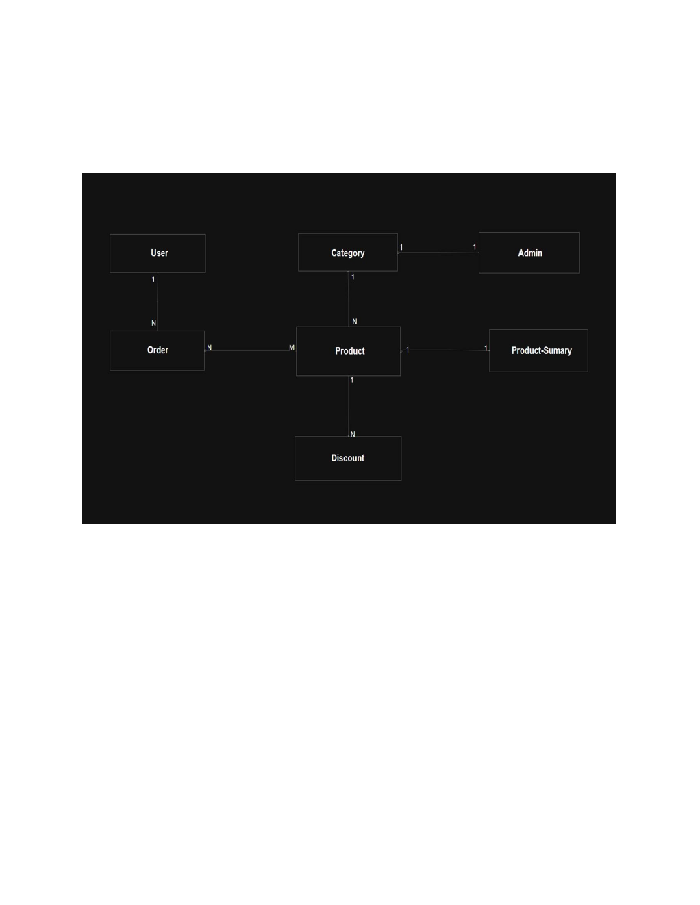

# Enterprise E-Commerce Database Architecture & 3NF Normalization

**Role:** Database Designer & Systems Analyst

## 📌 System Scope
Architected a scalable, high-performance relational database system for an enterprise e-commerce platform covering **User Management**, **Role-Based Access Control**, **Order Processing**, **Payment Gateway Tracking**, **Inventory Control**, **Shipping**, and **Returns**.

## 🛠️ Technical Implementation
- Developed complete **Entity-Relationship Diagrams (ERD)** and **Extended ERDs (EERD)** mapping complex One-to-Many and Many-to-Many business dependencies.
- Rigorously applied **3rd Normal Form (3NF)** across **10 core system tables** to eliminate data redundancy, prevent insertion/deletion anomalies, and streamline transactional queries.

## 📄 Project Documentation
- [Full Database Documentation & Schema Report (PDF)](DataBaseProjectt.pdf)

## 🧩 Tech Stack
- **SQL**
- **Relational Database Modeling**
- **ERD/EERD**
- **Database Normalization (3NF)**

## 🖼️ Architecture & Schema Preview

